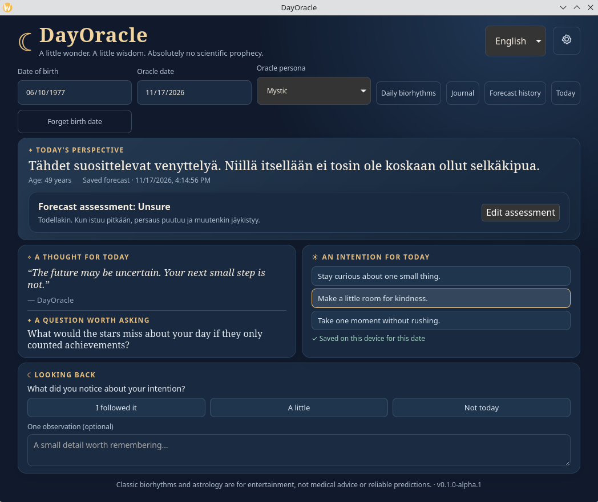
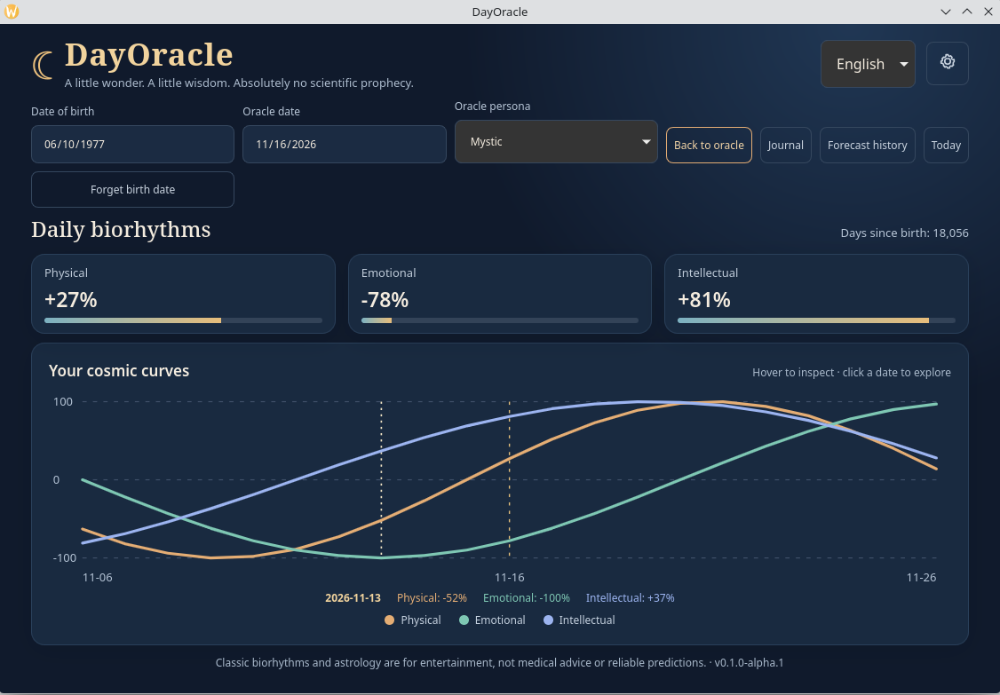
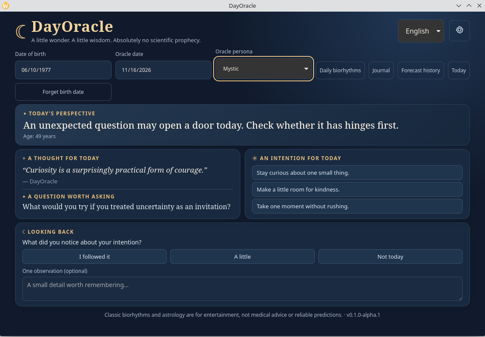
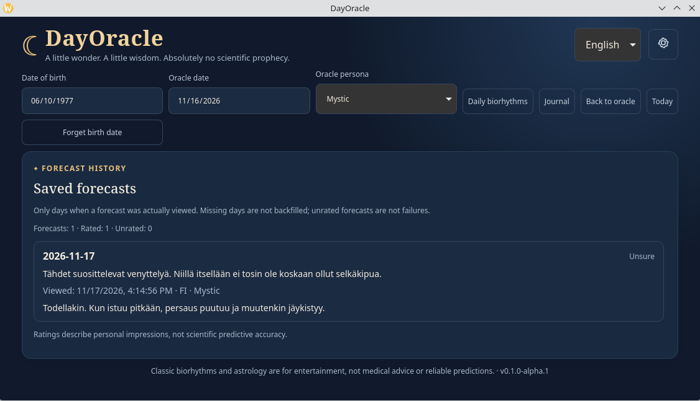
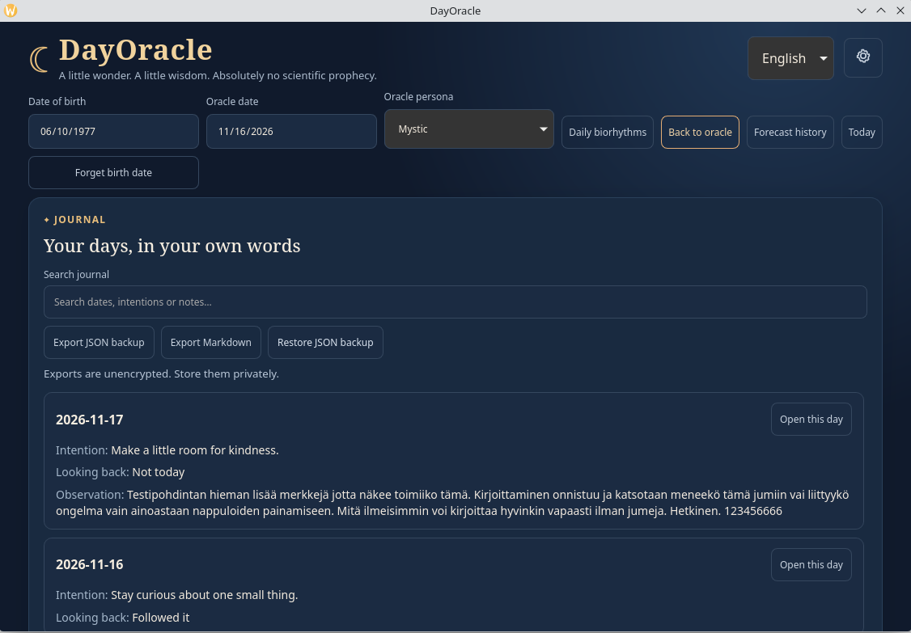

# DayOracle

*A little wonder. A little wisdom. Absolutely no scientific prophecy.*

DayOracle is a small, offline-first desktop app for playful daily perspectives, biorhythm visualizations, and private reflection. It combines a deliberately unscientific oracle with an optional journal and a history of forecasts you actually viewed.

Built with **Rust, Tauri 2, React, and TypeScript**. Interface languages: **English and Finnish**.

> **Entertainment, not science.** Traditional 23/28/33-day biorhythms and astrology do not reliably predict mood, health, intelligence, or future events. DayOracle is not a medical, diagnostic, or crisis-support tool. Forecast ratings are subjective impressions, not evidence of predictive accuracy.

## Screenshots

Screenshots from a pre-release development build (some footer labels still show v0.1.0-alpha.1).

### Daily perspective



### Daily biorhythms



### Mystic oracle



### Forecast history



Saved forecasts preserve their original language and wording even when the interface language changes.

### Journal



Additional screenshots, including the Skeptic persona, settings and encrypted journal lock screen, are available in [docs/images](docs/images/).

## Features

- Playful daily perspectives with **Mystic** and **Skeptic** voices
- Classic physical (23-day), emotional (28-day), and intellectual (33-day) biorhythm curves calculated in Rust, with an interactive 21-day chart
- Short philosophical thoughts and prompts in English and Finnish
- Optional daily intentions and evening reflections
- **Saved forecast history**: a day's first viewed forecast is preserved, including its original language and persona; days when you never opened the app are not filled in
- Optional retrospective assessment (**felt accurate / partly / did not fit / unsure**), with a note; assessment time can be 15:00, 18:00, 21:00, or anytime
- Local journal, search, backup import/export, and user-controlled deletion
- Optional password-protected encrypted journal vault using AES-256-GCM and Argon2-based key derivation

The app does **not** require daily use or ratings. Unrated forecasts are not counted as failures. A forecast first seen in the evening is labeled accordingly.

## Privacy and limitations

- No account, analytics, telemetry, or cloud/AI service is required for normal use.
- Your data stays on your device unless **you choose** to export or share it.
- The encrypted vault is **optional**; do not assume that data saved without it is encrypted.
- Exported **plaintext JSON/Markdown backups are not encrypted**. Store and share them carefully. An encrypted-vault export is a separate option.
- Encryption is not a substitute for a security audit. **This alpha has not been independently audited.** Do not use it as the sole storage for irreplaceable or highly sensitive information.
- A forecast viewed for the first time late in the day is not an advance prediction. Retrospective ratings can be influenced by hindsight and selection effects.
- Alpha software may contain bugs. Keep backups of anything you want to preserve.

## Installation

Downloadable packages will appear under [GitHub Releases](https://github.com/ollavarma-create/dayoracle/releases) after platform-specific builds have been tested. **A package is not yet published as part of this preparation PR.**

For now, build from source.

### Run from source (Fedora / Linux)

Prerequisites: Node.js 22+, npm, Rust via rustup, and the native Tauri 2 development libraries for your distribution. On Fedora, see the [official Tauri 2 prerequisites](https://v2.tauri.app/start/prerequisites/).

```bash
git clone https://github.com/ollavarma-create/dayoracle.git
cd dayoracle
npm install
npm test
npm run build
npm run tauri dev
```

Build desktop bundles on the target platform:

```bash
npm run tauri build
```

The first Rust/WebKitGTK compilation can take some time. A successful build does not by itself mean that every generated installer format has been tested.

## Development and checks

```bash
npm test
npm run build
cargo fmt --manifest-path src-tauri/Cargo.toml --all -- --check
cargo test --manifest-path src-tauri/Cargo.toml --locked
```

GitHub Actions runs frontend tests, a TypeScript/production build, and Rust checks on pull requests.

## What to test

Feedback is especially welcome on:

1. Linux desktop installation, startup, and window layout at different sizes.
2. Forecast persistence across restarts and language/persona changes.
3. Empty journal, skipped days, optional ratings, and editing/canceling an assessment.
4. Encrypted vault creation/unlock, backup/restore, and recovery from invalid inputs.
5. Finnish/English UI text, accessibility, and usability.

Please report the **OS/distribution and version**, DayOracle version, steps to reproduce, expected versus actual behavior, and any relevant logs in [GitHub Issues](https://github.com/ollavarma-create/dayoracle/issues). **Do not attach passwords, vault contents, or personal journal entries.**

## Architecture

- `src-tauri/src/biorhythm.rs`: deterministic biorhythm calculations
- `src-tauri/src/`: Tauri command boundary and encrypted vault implementation
- `src/App.tsx`: desktop interface and state coordination
- `src/forecast-history.ts`: immutable forecast snapshots and subjective assessments
- `src/journal-backup.ts`: local backup format and validation
- `src/vault-client.ts`: frontend encrypted-vault boundary

Calendar-day differences use `chrono::NaiveDate` to avoid local daylight-saving-time shifts affecting day counts.

## Status and roadmap

**v0.2.0-alpha.1 — release preparation.** Planned next: verify platform bundles, add screenshots, improve accessibility and translations, and incorporate early tester feedback. Optional external/local LLM integrations may be explored later; they are **not part of this alpha**.

Contributions, bug reports, and constructive skepticism are welcome.

License: **MIT**.
